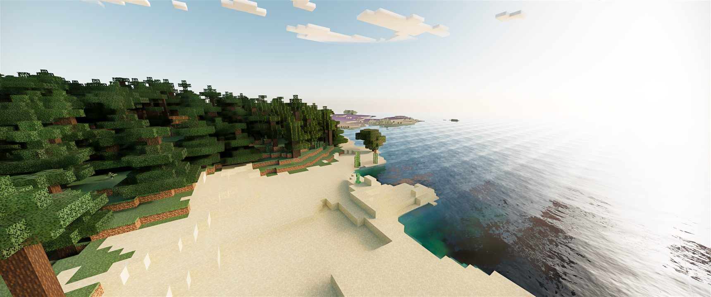
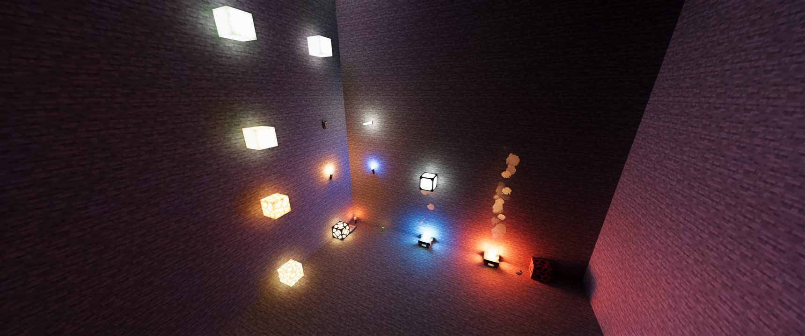
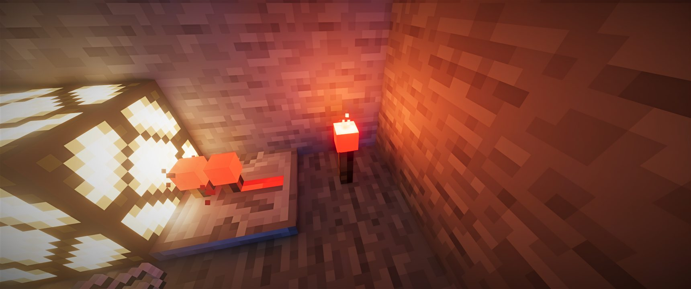

<div align="center">

# RTX Remix for Minecraft · 26.3

**Real-time path tracing for Minecraft Java Edition 26.3, powered by NVIDIA RTX Remix.**

A community port of [NVIDIA's RTX Remix for Minecraft](https://github.com/NVIDIAGameWorks/rtx-remix-minecraft) from 1.21.1 to the first unobfuscated generation of Minecraft.

[](https://www.minecraft.net/)
[](https://fabricmc.net/)
[](https://adoptium.net/)
[](https://github.com/NVIDIAGameWorks/rtx-remix)
[](LICENSE)

[](https://github.com/NVIDIAGameWorks/rtx-remix-minecraft/pull/79)




</div>

---

## ✨ What this is

The original mod renders Minecraft **1.21.1** through RTX Remix, and its README hopes the community will port it to newer versions. This fork does that for **Minecraft 26.3**: every block, mob, item, particle, the sky and the clouds are lit by a path tracer, with the same feature set as upstream 0.1.0.

Minecraft 26.x is a different engine underneath: it ships unobfuscated, renders through the new *renderpearl* layer and SDL3, and draws the world through an **extract → submit** pipeline. Most of this port is therefore a port of APIs, not names.

<table>
<tr>
<td width="50%"></td>
<td width="50%"></td>
</tr>
<tr>
<td align="center"><sub>Every light source is a real light: torches, lanterns, glowstone</sub></td>
<td align="center"><sub>Redstone lamps and torches tint the room they light</sub></td>
</tr>
</table>

## 🚀 What changed in the port

| Area | 1.21.1 (upstream) | 26.3 (this fork) |
|---|---|---|
| Mappings | Yarn, remapped to intermediary | None: the game is unobfuscated |
| Toolchain | Loom 1.15, Java 21, Gradle 9.3 | Loom 1.19, **Java 25**, Gradle 9.8 |
| Window and input | GLFW | SDL3, OpenGL 4.5 core backend forced for Remix interop |
| Terrain capture | `ChunkBuilder`, Yarn models | `SectionCompiler`, `BlockStateModel` parts, per-quad layers |
| Entities | Immediate `MultiBufferSource` rendering | `SubmitNodeCollector` capture of extracted render states |
| Animated textures | CPU uploads | GPU-side animation, forwarded from the animation tick |

Highlights:

- 🧱 **Terrain** captured from 26.x section compilation, with the atlas padding 26.x introduced filled on every CPU-side atlas copy, so distant blocks stay clean.
- 🐄 **Entities, block entities, held items and the breaking crack** captured from the new extract and submit pipeline, evaluated once rather than twice.
- 🔥 **New 26.x light sources**: copper torches and copper lanterns cast light and glow.
- 🧪 **Bytecode-checked mixins**: 26.x has no refmap, so every mixin was verified against the 26.3 client jar: call sites, `@Shadow` descriptors and handler signatures.

The full list is in the [changelog](CHANGELOG.md) and in [upstream PR #79](https://github.com/NVIDIAGameWorks/rtx-remix-minecraft/pull/79).

## 📋 Requirements

- Windows 10 or 11, x64.
- Minecraft Java Edition **26.3** on a Microsoft account that owns the game.
- A GeForce RTX 30-series or newer GPU, NVIDIA driver 616.92 or newer.
- **Java 25**, Fabric Loader **0.20.1** and Fabric API **0.165.0+26.3**.
- 16 GB of system memory recommended.

## 🛠️ Install

**With the installer.** Build the release archive (see [Build from source](#-build-from-source)), extract it, and run `install.bat`. It sets up a Prism Launcher or Minecraft Launcher profile for **Minecraft 26.3** with **Fabric Loader 0.20.1**, **Fabric API 0.165.0+26.3** and **Java 25**, which it downloads when your machine has none. Upgrading an install of upstream 0.1.0 moves its Prism instance to 26.3. [Playing](docs/PLAYING.md) walks through it.

**By hand**, in a launcher you already use:

1. Create an instance for **Minecraft 26.3** with **Fabric Loader 0.20.1**, running on **Java 25**.
2. Put [Fabric API 0.165.0+26.3](https://modrinth.com/mod/fabric-api) and the mod JAR into the instance's `mods` folder.
3. Launch. On first start the mod unpacks the RTX Remix runtime next to the game; the Remix menu opens with **Alt+X**.

A 1.21.1 world opens in 26.3 after Minecraft's usual upgrade, and zones you saved with `/rtx zone define` come along. Keep a copy of the original if you still play it on 1.21.1.

## 🧩 Build from source

```powershell
git clone https://github.com/AlexMelanFromRingo/rtx-remix-minecraft.git
cd rtx-remix-minecraft
$env:JAVA_HOME = "C:\Path\To\jdk-25"
.\gradlew.bat build test
.\gradlew.bat package -Parch=win64
```

`build` compiles the JNI bridge too, so the Visual Studio C++ tools are needed; `package` writes the JAR with the embedded runtime to `build\distributions\`, and `.\gradlew.bat releaseArchive` builds the installer archive next to it. [Getting Started](docs/GETTING_STARTED.md) covers the toolchain, runtime staging and local overrides.

## ⚠️ Status and known gaps

This is an **alpha** port, played and tested on one machine.

- ✅ World load and upgrade, terrain near and far, block lights, day and night sky, clouds, water, entities, particles, held and thrown items, the Copper Beacon.
- ✅ The installer, the developer launcher (`tools\rtx.bat`) and the docs target 26.3 and Java 25; zones from 1.21.1 saves carry over.
- 🧪 Not yet run end to end: the installer itself, and anything on ARM64 hardware.
- ℹ️ The redstone torch was redesigned in 26.x with an opaque red shell around its head; under path tracing it reads as a glowing cube, which is vanilla's geometry.

Found something broken? [Open an issue](https://github.com/AlexMelanFromRingo/rtx-remix-minecraft/issues) with a screenshot and `logs/latest.log`.

## 📚 Documentation

| You want to | Read |
|---|---|
| Configure the renderer | [Settings](docs/SETTINGS.md) |
| Look up a command, key or mod-added block | [In-Game Guide](docs/IN_GAME_GUIDE.md) |
| Record camera flythroughs | [Camera Paths](docs/CAMERA_PATHS.md) |
| Make resource packs with PBR materials | [Resource Packs](docs/RESOURCE_PACKS.md) |
| Build, debug and contribute | [Getting Started](docs/GETTING_STARTED.md) · [Contributing](CONTRIBUTING.md) |

## 🤝 Upstream

Everything here is offered back to the original project:

- [#77](https://github.com/NVIDIAGameWorks/rtx-remix-minecraft/pull/77): pick a Visual Studio install that has MSVC in the bridge build
- [#78](https://github.com/NVIDIAGameWorks/rtx-remix-minecraft/pull/78): migrate from Yarn to Mojang mappings on 1.21.1
- [#79](https://github.com/NVIDIAGameWorks/rtx-remix-minecraft/pull/79): port the renderer, installer and tools to Minecraft 26.3 (in review)

## 📜 License and credits

Apache License 2.0, see [LICENSE](LICENSE), [NOTICE](NOTICE) and [third-party notices](THIRD_PARTY_NOTICES.md). The renderer, the RTX Remix runtime integration and the baseline materials are the work of NVIDIA's [RTX Remix for Minecraft](https://github.com/NVIDIAGameWorks/rtx-remix-minecraft) team; this fork carries their work to 26.3.

<sub>An unofficial community fork, not affiliated with or endorsed by NVIDIA. NOT AN OFFICIAL MINECRAFT PRODUCT. NOT APPROVED BY OR ASSOCIATED WITH MOJANG OR MICROSOFT. NVIDIA and RTX are trademarks of NVIDIA Corporation; Minecraft is a trademark of Mojang Synergies AB.</sub>
